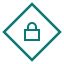

<p align="center">
  
  
</p>

<h1 align="center">Privacy Compliance Rules</h1>
<p align="center">By Søren Schytz Birk</p>

Workflow Analyzer rules for UiPath Studio. They find personal data and other privacy risks (GDPR) in a project before it is published to Orchestrator.

The defaults are set for Danish organisations: CPR numbers, Danish and English names, and Danish and EU domains. Most of them are rule parameters you can change. See [Defaults and other countries](#defaults-and-other-countries).

## Install

Package ID: `SorenB.Rules.Privacy`. Built against `UiPath.Activities.Api` 23.10.3 (Studio 2023.10), targeting `net6.0`. Download the `.nupkg` from [Releases](https://github.com/sorenbcoding/privacy-compliance-rules/releases).

| Option | Scope | How |
| --- | --- | --- |
| Project dependency | One project | Add the folder or feed that holds the `.nupkg` as a package source, then install `SorenB.Rules.Privacy` in **Manage Packages**. |
| Custom rules location | Every project in Studio | Extract `lib/net6.0/SorenB.Rules.Privacy.dll` from the `.nupkg` into the folder set in **Home > Settings > Locations > Custom Workflow Analyzer rules location**, then restart Studio. |

All rules default to severity Error. If the Workflow Analyzer is enforced on publish, a project with an error can't be published. See [Enforce the rules on publish](https://github.com/sorenbcoding/privacy-compliance-rules/blob/main/docs/enforce-on-publish.md).

Rolling the rules out to a team? See the [recommended governance baseline](https://github.com/sorenbcoding/privacy-compliance-rules/blob/main/docs/governance-baseline.md) for the Automation Ops settings, central rule parameters and package restrictions that complete them.

Upgrading from `GDPR.Compliance.Workflow.Analyzer.Rules`? See [Upgrade from 1.x to 2.0](https://github.com/sorenbcoding/privacy-compliance-rules/blob/main/docs/migrate-to-2.0.md).

## Defaults and other countries

The rules are written for Danish organisations. Outside Denmark, change these defaults before you enforce the rules, or `SB-SEC-005` blocks publishing for every non-Danish host.

| Rule | Parameter key | Default | What to change outside Denmark |
| --- | --- | --- | --- |
| [`SB-SEC-001`](https://github.com/sorenbcoding/privacy-compliance-rules/blob/main/docs/rules/SB-SEC-001.md) | `pin_in_code` | Danish CPR number pattern | Your national ID number pattern |
| [`SB-SEC-003`](https://github.com/sorenbcoding/privacy-compliance-rules/blob/main/docs/rules/SB-SEC-003.md), [`SB-SEC-004`](https://github.com/sorenbcoding/privacy-compliance-rules/blob/main/docs/rules/SB-SEC-004.md) | `personal_data_names`, `personal_data_ignored_names` | Danish and English names, such as `navn`, `elev`, `email`, `phone` | Add the names used in your language and systems |
| [`SB-SEC-005`](https://github.com/sorenbcoding/privacy-compliance-rules/blob/main/docs/rules/SB-SEC-005.md) | `approved_domains` | `*.dk;*.eu;*.uipath.com` | Your approved domains, for example `*.se;*.eu;*.uipath.com` |
| [`SB-SEC-006`](https://github.com/sorenbcoding/privacy-compliance-rules/blob/main/docs/rules/SB-SEC-006.md) | `secret_names` | English and Danish words, such as `password`, `kodeord` | Add the words for password and secret in your language |

`SB-SEC-003` and `SB-SEC-004` also check literal text for CPR numbers. That check is built in and is not a parameter, so outside Denmark these two rules find personal data by name only.

Set the parameters once for every developer through Automation Ops. See the [governance baseline](https://github.com/sorenbcoding/privacy-compliance-rules/blob/main/docs/governance-baseline.md).

## Quick example

A variable `CustomerId` has the default value `"010190-1234"`. **Analyze File** reports:

```
SB-SEC-001  Variable 'CustomerId' has a personal identification number in its default value. Values in workflow files are stored in source control, in the published package and in Orchestrator. Clear the default value and assign the number at runtime.
```

## Rules

| ID | Title | Scope | Default severity |
| --- | --- | --- | --- |
| [`SB-SEC-001`](https://github.com/sorenbcoding/privacy-compliance-rules/blob/main/docs/rules/SB-SEC-001.md) | Personal identification number in workflow | Activity | Error |
| [`SB-SEC-002`](https://github.com/sorenbcoding/privacy-compliance-rules/blob/main/docs/rules/SB-SEC-002.md) | Screenshots folder in project | Project | Error (Warning if git-ignored) |
| [`SB-SEC-003`](https://github.com/sorenbcoding/privacy-compliance-rules/blob/main/docs/rules/SB-SEC-003.md) | Personal data in log message | Activity | Error |
| [`SB-SEC-004`](https://github.com/sorenbcoding/privacy-compliance-rules/blob/main/docs/rules/SB-SEC-004.md) | Personal data in queue item | Activity | Error |
| [`SB-SEC-005`](https://github.com/sorenbcoding/privacy-compliance-rules/blob/main/docs/rules/SB-SEC-005.md) | Call to service outside approved regions | Activity | Error |
| [`SB-SEC-006`](https://github.com/sorenbcoding/privacy-compliance-rules/blob/main/docs/rules/SB-SEC-006.md) | Password or secret in workflow | Activity | Error |

Each rule's help link in Studio opens its page.

## Changelog

See [CHANGELOG.md](https://github.com/sorenbcoding/privacy-compliance-rules/blob/main/CHANGELOG.md). Rule IDs are listed in [RULE_IDS.md](https://github.com/sorenbcoding/privacy-compliance-rules/blob/main/RULE_IDS.md).

## License

MIT. See [LICENSE](https://github.com/sorenbcoding/privacy-compliance-rules/blob/main/LICENSE).

---

By Søren Schytz Birk · UiPath Community MVP · [github.com/sorenbcoding](https://github.com/sorenbcoding)

Privacy Compliance Rules is an independent open-source project by Søren Schytz Birk (github.com/sorenbcoding) and is not affiliated with, endorsed by, or sponsored by UiPath. UiPath and related names are trademarks of UiPath Inc.
